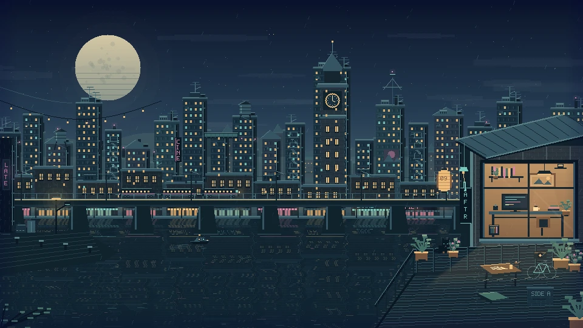
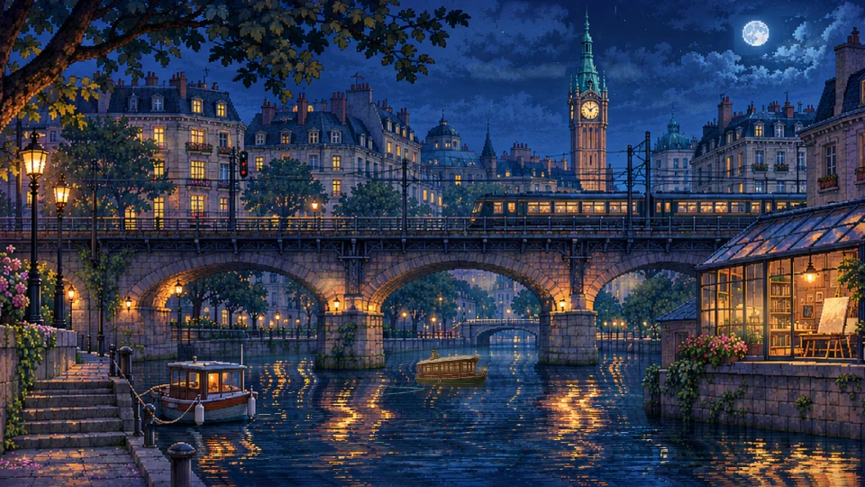

# Afterlight

Afterlight is an interactive pixel-art wallpaper for Windows. Explore nine worlds, switch between Day and Night, and click the scenery to set things in motion. Created by Sadeq Rezai.

## Download for Windows

| Edition | What you get | Installer |
| --- | --- | --- |
| **Afterlight Classic** | The original code-drawn pixel-art worlds, with crisp silhouettes and a simpler visual style. Appears as **Afterlight** in Windows. | [Download Classic](https://github.com/Rammeshgar/afterlight/releases/download/v1.8.0/Afterlight-Setup-1.8.0.exe) |
| **Afterlight Cinema** | Illustrated pixel-art worlds with moving skies, water and reflections, more detailed vehicles, and additional scene interactions. | [Download Cinema](https://github.com/Rammeshgar/afterlight/releases/download/v1.8.0/Afterlight-Cinema-Setup-1.8.0.exe) |

The two apps can be installed side by side and save their settings separately. To switch desktop wallpapers, quit the current edition from its tray icon, then select **Use as wallpaper** in the other one.

See the [v1.8.0 release](https://github.com/Rammeshgar/afterlight/releases/tag/v1.8.0) for release notes, installers, and SHA-256 checksums. The installers are unsigned, so Windows may display an unknown-publisher warning.

## Canal City in both editions

| Classic | Cinema |
| --- | --- |
|  |  |

## Getting started

1. Run the installer for your edition. Setup installs for your Windows account.
2. Open **Afterlight** or **Afterlight Cinema** from the Start menu. Pick a scene, then select **Use as wallpaper**.
3. Double-click the tray icon to reopen the controls. **Explore** shows what you can interact with. **Make it yours** has lighting, weather, rotation, and motion settings.

Press **D** in preview to switch Day and Night, **E** to open Explore, **S** for settings, and **Space** to pause. You can also set lighting to **Follow Windows** or select **Stillness** for a static scene.

## Requirements

Windows 10 or 11 on x64, .NET Framework 4.8, and the Microsoft Edge WebView2 Runtime. Setup checks for missing prerequisites.

Scene preferences are stored locally. Music reaction is optional and off at startup. When enabled, it reacts to the default Windows playback device. [Privacy details](PRIVACY.md)

## Build from source

This repository contains the Windows host, both renderers, bundled artwork, and the installer source. [Build and test instructions](BUILDING.md)

Artwork, interface, and application by Sadeq Rezai. [Rights and third-party notices](NOTICE.md)
